<div align="center">
  <a href="https://git.io/typing-svg">
    
  </a>
</div>

##

```python
#!/usr/bin/python
# -*- coding: utf-8 -*-

class Developer:
    def __init__(self):
        self.name = "Addiel Anthonny"
        self.role = "Systems Analysis and Development Student"
        self.focus = "front-end developer"

     def say_hi(self):
        print("Here I share my progress.")

me = Developer()
me.say_hi()
```

##


## 🛠️ Linguagens e tecnologias

  
  &nbsp;
  
  &nbsp;
  
  &nbsp;
  


<br clear="all" />


##
 
<picture data-importer="pacman">
  <source media="(prefers-color-scheme: dark)" srcset="https://raw.githubusercontent.com/arguedas0/arguedas0/pacman-output/pacman-contribution-graph-dark.svg?game=pacman">
  <source media="(prefers-color-scheme: light)" srcset="https://raw.githubusercontent.com/arguedas0/arguedas0/pacman-output/pacman-contribution-graph.svg?game=pacman">
  
</picture>
<div align="center">
  <sub>Atualizado automaticamente todos os dias</sub>
</div>
