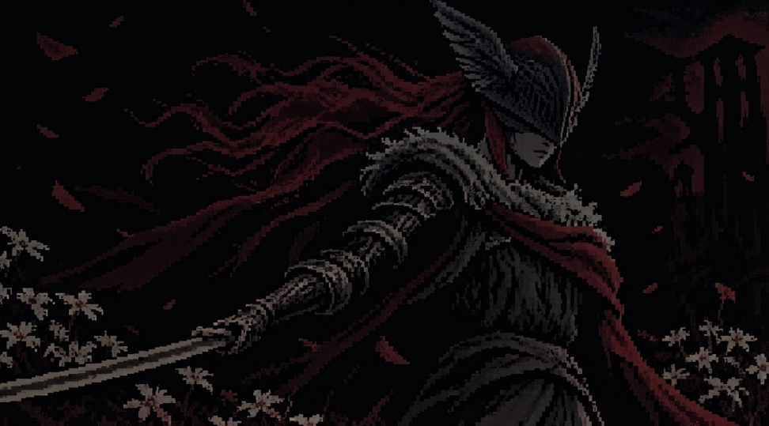

<div align="center">
  <a href="https://git.io/typing-svg">
    
  </a>
</div>

##

```python
#!/usr/bin/python
# -*- coding: utf-8 -*-

class Developer:
    def __init__(self):
        self.name = "Addiel Anthonny"
        self.role = "Systems Analysis and Development Student"
        self.focus = "Front-End Development"

    def say_hi(self):
        print("Here I share my progress.")

me = Developer()
me.say_hi()
```

###


```python
self.about_me = (

    "I'm passionate about technology and software development. "
    "Always curious to explore new technologies, solve problems, "
    "and expand my knowledge. Currently developing my skills in "
    "programming, algorithms, databases, and web development. "

)
```


## 🛠️ Languages and Technologies

  <div>
  
</div>


##
 
<picture data-importer="pacman">
  <source media="(prefers-color-scheme: dark)" srcset="https://raw.githubusercontent.com/arguedas0/arguedas0/pacman-output/pacman-contribution-graph-dark.svg?game=pacman">
  <source media="(prefers-color-scheme: light)" srcset="https://raw.githubusercontent.com/arguedas0/arguedas0/pacman-output/pacman-contribution-graph.svg?game=pacman">
  
</picture>
<div align="center">
  <sub>Atualizado automaticamente todos os dias</sub>
</div>
